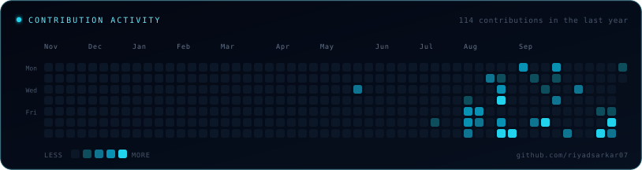

<!--
  Riyad Sarkar - GitHub Profile
  Generated from profile.config.json. Edit the config, then run: npm run generate
-->

  <picture>
    <source media="(max-width: 760px)" srcset="./assets/banner-mobile.svg">
    
  </picture>

  

<h1 align="center">Hi, I'm Riyad Sarkar</h1>

  
  
  
  

  
  
  

  

  

## About Me

I am Riyad Sarkar, a cybersecurity and AI professional based in Bangladesh. My work sits at the intersection of defensive security, digital recovery, and applied artificial intelligence.

I study how accounts, identities, and business systems are attacked, and I build practical defenses around them. On the AI side, I work on agent platforms and automation that turn model capabilities into software people can actually use.

My public repositories document that work in progress: security-focused web applications, multi-provider AI agent platforms, and automation tooling built with Next.js, TypeScript, Supabase, and Firebase.

  

## Professional Identity

| Field | Detail |
| --- | --- |
| **Role** | Cybersecurity Expert &amp; AI Expert |
| **Focus** | Security research, applied AI, automation |
| **Base** | Bangladesh |
| **Building** | AI agent platforms and security-focused web systems |
| **Open source** | AI agents, automation, security web apps |

  

## Cybersecurity Interests

| Area | How I approach it |
| --- | --- |
| **Information Security** | Protecting accounts, identities, and business assets with layered defensive controls. |
| **Ethical Hacking** | Thinking like an attacker to find weaknesses before they become incidents. |
| **Network Security** | Hardening infrastructure and monitoring threats across connected environments. |
| **Web Application Security** | Reviewing modern web apps for authentication, authorization, and data exposure risks. |
| **Vulnerability Assessment** | Systematic review of exposure, misconfiguration, and weakness before exploitation. |
| **Security Research** | Studying attack patterns, recovery paths, and practical defenses for real incidents. |

## Artificial Intelligence Interests

| Area | How I approach it |
| --- | --- |
| **Applied AI** | Turning model capabilities into useful, testable software systems. |
| **AI Agents** | Tool use, multi-provider failover, and reliable agent APIs. |
| **AI Automation** | Connecting models to workflows, messaging platforms, and business systems. |
| **LLM Engineering** | Streaming responses, prompt design, and API contracts for production use. |

  

## Technical Skills &amp; Technologies

  

<strong>Languages</strong>

    

<strong>Frameworks</strong>

   

<strong>Data &amp; Cloud</strong>

  

<strong>AI Platforms</strong>

  

## Tools &amp; Technologies

<strong>Platform environments</strong>

<code>Meta</code> &#183; <code>Google</code> &#183; <code>Microsoft</code> &#183; <code>Google Workspace</code>

<strong>Security &amp; infrastructure</strong>

<code>Linux</code> &#183; <code>Windows</code> &#183; <code>Cloudflare</code> &#183; <code>AWS</code>

<strong>Build &amp; deploy</strong>

<code>GitHub</code> &#183; <code>Vercel</code> &#183; <code>Supabase</code> &#183; <code>Firebase</code>

<strong>AI platforms</strong>

<code>Google Gemini</code> &#183; <code>OpenAI</code> &#183; <code>Anthropic</code>

  

## Featured GitHub Projects

### [riyad.sarkar](https://github.com/riyadsarkar07/riyad.sarkar)

Animated personal portfolio presenting cybersecurity and digital recovery work, with service detail, credentials, and consultation flows.

`Next.js, React, TypeScript, Tailwind CSS` &#183; [**Live**](https://riyadsarkar-cyber.vercel.app/)

### [Omni-Agent](https://github.com/riyadsarkar07/Omni-Agent)

Universal AI agent platform with a versioned REST API, streaming chat, API key management, usage analytics, and a TypeScript SDK.

`Next.js, TypeScript, Google Gemini, Supabase` &#183; [**Live**](https://omniagent-amber.vercel.app)

### [My-Personal-Ai-Agent](https://github.com/riyadsarkar07/My-Personal-Ai-Agent)

Nexus Agent platform for creating reusable agents across apps, with model failover, project isolation, and rate-limited API access.

`Next.js, TypeScript, Supabase, multi-provider AI` &#183; [**Live**](https://mypersonalaiagent.vercel.app)

### [riyad-ai-automation](https://github.com/riyadsarkar07/riyad-ai-automation)

Foundation for a Facebook Messenger AI automation platform, with typed environment configuration and Firebase wiring in place.

`Next.js, TypeScript, Firebase, Zod`

  

## GitHub Statistics

  
  

  

## Contribution Activity

  

  

## Connect With Me

  
  
  

  Open to conversations about security research, applied AI, and automation.

  

## Build Secure Systems. Explore Intelligent Ones.

  

  Build secure systems. Explore intelligent ones. &#183; <a href="https://github.com/riyadsarkar07">github.com/riyadsarkar07</a>

